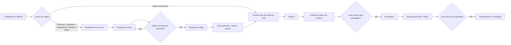

# Documentação técnica do modelo SIMUL8 — Cenário **As Is 2025**

> **Finalidade:** registrar, de forma estruturada e rastreável, como o modelo As Is 2025 funciona, quais decisões estão implementadas no Visual Logic, quais elementos são configurados nativamente no SIMUL8, quais saídas o modelo produz e como essas saídas são transformadas nos KPIs utilizados na validação do TCC.
>
> **Uso sugerido:** base técnica para a redação do Capítulo 4 do TCC. Este arquivo foi escrito para explicar o modelo, não para substituir o texto acadêmico final.

---

## 1. Escopo e fontes utilizadas

Esta documentação foi construída a partir do conjunto de arquivos do cenário **As Is 2025**:

- `Validação final teste com operador.S8` — arquivo do modelo SIMUL8;
- `VL AS IS 2025.txt` — exportação do Visual Logic;
- `Log caminhão.xlsx` — log customizado das etapas das viagens;
- `Log entradas.xlsx` — log customizado das chegadas de material;
- `Log Estoque.xlsx` — log customizado associado aos eventos de estoque;
- `Estoque inicial.xlsx` — fotografia do estoque no início do período oficial de análise pós-warm-up;
- `Validação RCCP x SIMUL8 - TCC.xlsx` — consolidação dos KPIs e comparação do modelo;
- `Rastreabilidade_KPIs_SIMUL8_AsIs_2025.md` — documentação anterior de rastreabilidade dos indicadores;
- imagens do modelo SIMUL8 e do fluxo conceitual da Green Mining;
- materiais de referência do projeto: *Simul8 101*, *Introdução ao SIMUL8* e *Modelagem e Simulação de Eventos Discretos*.

### 1.1. O que esta documentação consegue afirmar com segurança

Há três níveis de evidência diferentes no modelo:

1. **Configuração observável no arquivo/na interface do SIMUL8**: objetos, recursos, filas, atividades, ligações, capacidades, turnos e Results Manager;
2. **Lógica explícita no Visual Logic**: regras de chamada do caminhão, reserva e retirada de estoque, registros de log, conversões de massa/volume, triagem, prensagem, expedição e warm-up;
3. **Pós-processamento fora do SIMUL8**: agrupamentos, médias, conversões anuais/semanais e reconstruções temporais necessárias para alguns KPIs.

Quando uma propriedade está configurada diretamente em um objeto do SIMUL8 e não aparece na exportação do Visual Logic — por exemplo, certas distribuições de chegada ou propriedades nativas de roteamento — esta documentação **não inventa o valor**. Nesses casos, descreve-se o comportamento confirmado pelo modelo e registra-se a propriedade como uma configuração nativa a ser consultada no `.S8` caso seja necessária para a versão final do TCC.

---

# 2. Visão geral do sistema modelado

O cenário As Is 2025 representa a operação atual da rede de coleta e consolidação de materiais recicláveis da Green Mining. O sistema é composto por cinco centros externos de coleta e um Hub central em Santo Amaro.

## 2.1. Centros representados

| Código interno | Centro | Capacidade física de estoque |
|---:|---|---:|
| 1 | Pinheiros | 30 m³ |
| 2 | Jabaquara | 33 m³ |
| 3 | Paraisópolis | 33 m³ |
| 4 | Brooklin | 33 m³ |
| 5 | Embu das Artes | 33 m³ |
| 6 | Santo Amaro — Hub | 493 m³ |

A capacidade agregada dos cinco centros externos é:

```text
30 + 33 + 33 + 33 + 33 = 162 m³
```

## 2.2. Materiais modelados

O modelo diferencia três famílias:

| Código | Material |
|---:|---|
| 1 | Papelão |
| 2 | Plástico |
| 3 | Longa Vida |

**Embu das Artes não possui fluxo de Plástico no modelo As Is 2025.** Isso aparece tanto na arquitetura dos Start Points quanto nos resultados de demanda, em que o volume e a quantidade de chegadas desse material em Embu são nulos.

## 2.3. Macroprocesso

O fluxo representado pode ser resumido em quatro blocos:

1. **Entrada e recebimento de materiais** nos centros externos e diretamente no Hub;
2. **Acumulação de estoque e acionamento logístico** quando o volume dos centros atinge a regra de chamada do caminhão;
3. **Coleta, transporte e descarga no Hub Santo Amaro**;
4. **Triagem, prensagem, armazenagem de fardos e expedição** a partir do Hub.



---

# 3. Estrutura do modelo no SIMUL8

O modelo foi implementado com os objetos clássicos de Simulação de Eventos Discretos: **Start Points, Queues, Activities, Resources e End Points**, complementados por variáveis globais, labels e Visual Logic.

## 3.1. Bloco de chegada e recebimento

Há Start Points específicos por centro e material. Entre os nomes identificados no modelo estão:

- `Chegada_Pinheiros_Papelao`
- `Chegada_Pinheiros_Plastico`
- `Chegada_Pinheiros_LongaVida`
- `Chegada_Jabaquara_Papelao`
- `Chegada_Jabaquara_Plastico`
- `Chegada_Jabaquara_LongaVida`
- `Chegada_Paraisopolis_Papelao`
- `Chegada_Paraisopolis_Plastico`
- `Chegada_Paraisopolis_LongaVida`
- `Chegada_Brooklin_Papelao`
- `Chegada_Brooklin_Plastico`
- `Chegada_Brooklin_LongaVida`
- `Chegada_Embu_Papelao`
- `Chegada_Embu_LongaVida`
- `Chegada_Santo_Amaro_Papelao`
- `Chegada_Santo_Amaro_Plastico`
- `Chegada_Santo_Amaro_LongaVida`.

Depois da geração, os itens passam por rotinas do tipo `Set_Entrada_*` e por atividades de recebimento, por exemplo:

- `PIN Recebimento PAP`, `PIN Recebimento PLA`, `PIN Recebimento LV`;
- `JAB Recebimento PAP`, `JAB Recebimento PLA`, `JAB Recebimento LV`;
- equivalentes para Paraisópolis, Brooklin, Embu e Santo Amaro.

## 3.2. Bloco de estoque e chamada do caminhão nos centros

Cada centro externo possui um bloco logístico com estrutura equivalente. O diagrama contém objetos como:

- `Estoque <Centro>`;
- `Chama caminhão <Centro>`;
- fila/reserva do caminhão;
- atividade de preparação;
- `Deslocamento_Caminhao_<Centro>`;
- reserva complementar;
- coleta;
- transporte de retorno;
- descarga em Santo Amaro.

Essa repetição é intencional: a lógica é a mesma em essência, mas cada centro possui tempos de deslocamento, dados de entrada e variáveis próprias.

## 3.3. Recursos de operadores nos centros

O modelo possui recursos de operadores associados às atividades de recebimento/manuseio. Foram identificados, por exemplo:

- Pinheiros: `PIN operador 1`, `PIN operador 2` e pool de operadores;
- Jabaquara: dois operadores e pool;
- Paraisópolis: dois operadores e pool;
- Brooklin: dois operadores e pool;
- Embu: três operadores e pool.

O KPI de utilização da equipe mais carregada é extraído do **Results Manager**, respeitando a disponibilidade real do recurso, inclusive seus turnos e restrições.

## 3.4. Recurso caminhão

O cenário As Is utiliza **um caminhão** com capacidade volumétrica:

```text
gv_CapacidadeCaminhao = 10 m³
```

O veículo é compartilhado pelas cinco rotas dos centros externos para o Hub. Como é um recurso único, a ocupação desse recurso e a sequência de chamadas são elementos centrais para a dinâmica do sistema.

## 3.5. Hub Santo Amaro

No Hub aparecem os seguintes grandes blocos:

- recebimento/descarga;
- `Fila_Estoque_SantoAmaro`;
- `Triagem`;
- estoques triados por material;
- chamadas para prensa;
- filas e atividades de prensagem;
- estoque de material prensado/fardos;
- `Aguardar_Caminhao_Expedicao`;
- `Carregamento`;
- saída/expedição.

### Recursos do Hub

O modelo inclui:

- seis operadores de Santo Amaro e pool compartilhado;
- duas instâncias de recurso de prensa grande;
- quatro instâncias de recurso de prensa pequena.

Os percentuais de utilização desses recursos são coletados diretamente pelo SIMUL8.

---

# 4. Representação das entidades por labels

A entidade que flui pelo modelo carrega informações por meio de **labels**. Essas labels são utilizadas como estado móvel da entidade e permitem que uma mesma classe de Work Item represente situações diferentes.

Entre as labels relevantes identificadas no Visual Logic estão:

| Label | Função principal |
|---|---|
| `lbl_TipoItem` | diferencia item de entrada, item logístico/fardo etc. |
| `lbl_Centro` / `lbl_CentroRota` | identifica centro de origem ou rota do caminhão |
| `lbl_Familia` / material | identifica Papelão, Plástico ou Longa Vida |
| `lbl_PesoKg` | massa do item |
| `lbl_VolumeM3` | volume do item |
| `lbl_RotaEntrada` | indica se a entrada foi aceita ou recusada |
| `lbl_Capacidade` | capacidade do caminhão associada ao Work Item de viagem |
| `lbl_CargaAtual` | volume atualmente carregado no caminhão |
| `lbl_EspacoLivre` | espaço restante no caminhão |
| `lbl_QtdReservada` | volume reservado para coleta |
| `lbl_RotaReserva` | estado da rota de reserva |
| `lbl_RotaColeta` | estado da rota de coleta |
| `lbl_IDViagemCaminhao` | identificador utilizado no log de viagem |
| `lbl_EtapaCaminhao` | etapa corrente da viagem |
| `lbl_TempoInicioEtapa` | instante de início da etapa |
| `lbl_TempoEsperadoEtapa` | duração de referência da etapa |
| `lbl_TempoInicioViagem` | instante de início da viagem |
| `lbl_CargaM3_*` | carga volumétrica por material |
| `lbl_CargaKg_*` | massa carregada por material |
| `lbl_CargaQtd_*` | quantidade de itens por material |

A utilização de labels reduz a necessidade de criar uma classe de entidade diferente para cada combinação de centro/material/rota e permite que o Visual Logic faça decisões condicionais com base no atributo da entidade corrente.

---

# 5. Inicialização do caminhão

Há blocos de lógica equivalentes (`New Code25` a `New Code29`) executados para preparar a entidade que representa a viagem do caminhão.

A inicialização executa, em essência:

```text
lbl_QtdItensCarga = 0
lbl_TipoItem = 2
lbl_Capacidade = gv_CapacidadeCaminhao
lbl_CargaAtual = 0
lbl_EspacoLivre = lbl_Capacidade
lbl_Complemento = lbl_Capacidade
lbl_QtdColetar = 0
lbl_QtdReservada = 0
lbl_RotaColeta = 0
lbl_RotaReserva = 0
```

Também são zeradas todas as labels de carga específicas por material:

- `lbl_CargaM3_Papelao`, `lbl_CargaM3_Plastico`, `lbl_CargaM3_LongaVida`;
- `lbl_CargaKg_*`;
- `lbl_CargaQtd_*`.

Isso garante que uma nova viagem não herde carga ou estado da viagem anterior.

---

# 6. Lógica das chegadas aos centros externos

## 6.1. Princípio geral

Cada chegada externa executa uma rotina própria, porém com estrutura comum:

1. identifica centro e material;
2. atribui massa representativa ao evento;
3. atribui densidade aparente;
4. calcula o volume do item;
5. acumula a demanda gerada;
6. verifica espaço físico disponível no centro;
7. aceita integralmente, parcialmente ou recusa a entrada;
8. atualiza os estoques;
9. atualiza acumuladores de recusa, se necessário;
10. grava o evento no `ss_LogEntradas`;
11. grava uma fotografia de estoque no `ss_LogEstoque`.

## 6.2. Massa e densidade não são sorteadas evento a evento no Visual Logic

Um ponto importante para o TCC é que o Visual Logic usa **um valor de massa e uma densidade representativos por combinação centro-material**. O volume é calculado como:

```text
Volume_m3 = Peso_kg / Densidade_kg_por_m3
```

Portanto, a variabilidade do processo de chegada está associada à temporização dos Start Points e à dinâmica do sistema, enquanto o tamanho do evento, na lógica analisada, é fixado por tipo de chegada.

### Parâmetros por evento — centros externos

| Centro | Material | Peso por evento (kg) | Densidade (kg/m³) | Volume por evento (m³) |
|---|---|---:|---:|---:|
| Pinheiros | Papelão | 30,99 | 58,8567 | 0,526533 |
| Pinheiros | Plástico | 10,10 | 31,3622 | 0,322044 |
| Pinheiros | Longa Vida | 7,90 | 83,6327 | 0,094461 |
| Jabaquara | Papelão | 19,25 | 50,7938 | 0,378983 |
| Jabaquara | Plástico | 6,70 | 75,5112 | 0,088729 |
| Jabaquara | Longa Vida | 2,81 | 63,6475 | 0,044149 |
| Paraisópolis | Papelão | 45,17 | 29,2492 | 1,544316 |
| Paraisópolis | Plástico | 24,21 | 13,5938 | 1,780959 |
| Paraisópolis | Longa Vida | 16,95 | 36,2532 | 0,467545 |
| Brooklin | Papelão | 10,34 | 15,5537 | 0,664794 |
| Brooklin | Plástico | 2,06 | 30,7689 | 0,066951 |
| Brooklin | Longa Vida | 0,57 | 82,0607 | 0,006946 |
| Embu | Papelão | 56,10 | 73,9220 | 0,758908 |
| Embu | Longa Vida | 5,25 | 83,9557 | 0,062533 |

## 6.3. Cálculo do espaço físico efetivamente ocupado

O modelo distingue **estoque disponível** de **estoque reservado**. Para a decisão de capacidade física, ambos ocupam espaço. Assim, a lógica considera algo equivalente a:

```text
Estoque físico = Estoque disponível + Estoque reservado
Espaço livre = Capacidade do centro - Estoque físico
```

Essa distinção é necessária porque, ao chamar o caminhão, parte do material é transferida logicamente para variáveis de reserva para impedir dupla alocação, embora fisicamente continue dentro do centro até a coleta.

## 6.4. Aceitação integral, parcial e recusa

Nos centros externos, a lógica permite três situações:

### Entrada integral

Se o item inteiro cabe no espaço restante:

```text
Fator de aceitação = 1
```

Todo o peso, volume e quantidade entram no estoque.

### Entrada parcial

Se há espaço, mas não para o item completo:

```text
Fator de aceitação = Espaço livre / Volume do item
```

A parcela aceita é incorporada ao estoque e a parcela restante é contabilizada como recusa.

### Recusa total

Se não há espaço:

```text
Fator de aceitação = 0
```

Todo o evento é contabilizado nos acumuladores de recusa.

## 6.5. Variáveis de demanda gerada versus aceita

A demanda gerada é acumulada **antes** da verificação da capacidade. Dessa maneira, as variáveis `gv_*Gerado_*` representam a demanda tentada/gerada, enquanto o estoque representa apenas a parcela efetivamente aceita.

Essa separação é metodologicamente importante para cenários com saturação: o modelo consegue diferenciar “demanda que existiu” de “material que conseguiu entrar no sistema”.

---

# 7. Entradas diretas no Hub Santo Amaro

Santo Amaro também possui chegadas diretas de Papelão, Plástico e Longa Vida.

## 7.1. Parâmetros por evento

| Material | Peso por evento (kg) | Densidade (kg/m³) | Volume por evento (m³) |
|---|---:|---:|---:|
| Papelão | 41,42 | 49,7389 | 0,832749 |
| Plástico | 8,15 | 32,7346 | 0,248972 |
| Longa Vida | 8,47 | 65,6617 | 0,128995 |

## 7.2. Diferença de regra em relação aos centros externos

A entrada direta no Hub é mais restritiva: a lógica analisada **não faz aceitação parcial**. O evento é aceito somente se:

- o Hub não estiver bloqueado; e
- o volume completo do item couber na capacidade física disponível.

Caso contrário, o item é recusado integralmente.

Quando aceito, o evento:

- incrementa os acumuladores de entrada direta;
- incrementa o estoque não prensado do Hub;
- atualiza o estoque total do Hub;
- alimenta `ss_LogEntradas`.

---

# 8. Acionamento do caminhão

## 8.1. Regra de chamada

A regra de chamada utiliza:

```text
gv_CapacidadeCaminhao = 10 m³
gv_PercentualChamada = 150%
```

Logo, o limiar volumétrico é:

```text
10 × 150% = 15 m³
```

Nos blocos de verificação de rota, o caminhão não pode ser acionado se qualquer uma das seguintes condições ocorrer:

1. `gv_SantoAmaroBloqueado = 1`;
2. já existe uma reserva em andamento para aquele centro;
3. o estoque do centro é inferior ao limiar de chamada.

Em pseudocódigo:

```text
SE Hub está bloqueado -> não chamar
SE centro já está reservando carga -> não chamar
SE estoque do centro < 15 m³ -> não chamar
CASO CONTRÁRIO -> permitir chamada
```

## 8.2. Motivo para usar um limiar superior à capacidade do caminhão

O limiar de 15 m³ é maior que a capacidade de 10 m³ do caminhão. Assim, a chamada não ocorre assim que surge uma carga completa; ela exige um estoque adicional. Na prática, isso cria uma folga operacional e reduz chamadas muito frequentes por volumes marginais.

O modelo, contudo, reserva para a viagem uma carga limitada à capacidade do caminhão.

---

# 9. Reserva de estoque para a viagem

A reserva é uma das partes mais importantes da lógica porque evita que o mesmo estoque seja utilizado por duas decisões simultâneas.

## 9.1. Reserva inicial

Quando um centro inicia uma chamada, o modelo:

```text
gv_ReservandoCarga_<Centro> = 1
lbl_QtdReservada = Estoque do centro
SE lbl_QtdReservada > Capacidade do caminhão
    lbl_QtdReservada = Capacidade do caminhão
```

A entidade de viagem recebe:

- ID da viagem;
- código do centro;
- código da etapa = 1;
- instante de início da etapa;
- tempo esperado da etapa;
- instante de início da viagem.

## 9.2. Reserva por material

A rotina de reserva efetiva movimenta volume, massa e quantidade das variáveis de estoque disponível para variáveis de reserva:

- `gv_ResM3_<Centro>_Pap/Pla/Lon`;
- `gv_ResKg_<Centro>_Pap/Pla/Lon`;
- `gv_ResQtd_<Centro>_Pap/Pla/Lon`.

A reserva mantém a proporcionalidade entre volume, massa e quantidade por meio de um fator:

```text
FatorReserva = Volume a reservar / Estoque volumétrico do material
Kg reservado = EstoqueKg × FatorReserva
Qtd reservada = ROUND(EstoqueQtd × FatorReserva)
```

## 9.3. Critério de escolha dos materiais

A lógica prioriza materiais de acordo com o estoque em m³. Há rotinas que:

1. verificam um material prioritário (`gv_MatPri_<Centro>`);
2. procuram o maior estoque volumétrico entre os materiais restantes;
3. preenchem o espaço disponível até o limite do caminhão.

Assim, a composição da carga não é definida por um percentual fixo. Ela depende do estoque existente no instante da chamada.

---

# 10. Etapas da viagem do caminhão

O ciclo é registrado em quatro etapas lógicas:

| Etapa | Significado |
|---:|---|
| 1 | deslocamento Hub → centro |
| 2 | coleta/carregamento no centro |
| 3 | transporte centro → Hub |
| 4 | descarga no Hub |

## 10.1. Tempos de referência registrados no Visual Logic

Os valores a seguir são **tempos esperados de referência gravados no log** e não devem ser confundidos, automaticamente, com a distribuição completa configurada no Activity.

| Centro | Ida (min) | Coleta (min) | Retorno (min) | Descarga (min) | Ciclo nominal (min) |
|---|---:|---:|---:|---:|---:|
| Pinheiros | 48,333 | 20 | 51,667 | 30 | 150,000 |
| Jabaquara | 36,667 | 30 | 39,333 | 30 | 136,000 |
| Paraisópolis | 43,333 | 30 | 46,667 | 30 | 150,000 |
| Brooklin | 25,667 | 30 | 29,333 | 30 | 115,000 |
| Embu | 63,333 | 30 | 70,000 | 30 | 193,333 |

Esses tempos também permitem entender por que a rota de Embu consome significativamente mais tempo de recurso que a rota de Brooklin.

---

# 11. Coleta física no centro

As rotinas `New Code187` a `New Code191` efetivam a coleta.

## 11.1. Ajuste caso a reserva exceda o espaço real restante

Antes da coleta, o modelo verifica:

```text
Espaço livre = Capacidade - Carga atual
Reserva total = soma das reservas dos três materiais
```

Se a reserva total for maior que o espaço livre:

```text
FatorColeta = EspaçoLivre / ReservaTotal
```

A parte excedente da reserva é devolvida ao estoque do centro proporcionalmente.

Isso evita:

- carga superior a 10 m³;
- desaparecimento de estoque;
- reserva permanente de material que não foi levado.

## 11.2. Transferência para a carga do caminhão

O volume, a massa e a quantidade efetivamente coletados são adicionados às labels da viagem:

- `lbl_CargaM3_*`;
- `lbl_CargaKg_*`;
- `lbl_CargaQtd_*`.

E são acumulados em variáveis de desempenho por centro:

- `gv_M3Coletado_*`;
- `gv_KgColetado_*`;
- `gv_QtdColetada_*`.

Ao final:

- as reservas do centro são zeradas;
- o flag `gv_ReservandoCarga_<Centro>` é liberado;
- o estoque disponível é recalculado;
- a viagem segue para o retorno ao Hub.

---

# 12. Descarga no Hub e ocupação da viagem

Na descarga, as cargas por material são transferidas das labels para variáveis auxiliares do Hub.

A lógica também incrementa:

- `gv_QtdViagensHub`;
- `gv_M3TotalDescargadoHub`;
- `gv_QtdItensDescargadosHub`;
- acumuladores de kg/m³/quantidade por material no Hub.

## 12.1. Ocupação volumétrica customizada

O modelo calcula:

```text
OcupacaoViagem(%) = VolumeDescargado / CapacidadeCaminhao × 100
```

E mantém:

```text
gv_SomaOcupacaoCaminhao
gv_MediaOcupacaoCaminhao
```

Na rodada documentada, a média registrada foi de **100% de ocupação volumétrica**.

### Não confundir com utilização temporal

O Results Manager forneceu **79,58% de utilização temporal do recurso caminhão**.

Logo:

- **100%** = quanto da capacidade volumétrica das viagens foi ocupada;
- **79,58%** = quanto do tempo disponível do recurso caminhão esteve ocupado.

São conceitos diferentes e ambos podem ser verdadeiros ao mesmo tempo.

---

# 13. Desagregação da carga após a descarga

Durante o transporte, a carga do caminhão está agregada por material. Para voltar a processá-la como Work Items no Hub, a lógica `New Code214` reconstrói itens individuais aproximados.

A rotina:

1. identifica o material com maior volume restante para descarregar;
2. calcula a massa e o volume médios por item remanescente;
3. cria/libera um Work Item com esses atributos;
4. reduz os acumuladores de carga descarregada;
5. adiciona o item ao estoque não prensado do Hub.

Esse mecanismo permite conciliar dois níveis de representação:

- transporte agregado em m³/kg;
- processamento discreto de itens no Hub.

---

# 14. Bloqueio do Hub Santo Amaro

O Hub possui capacidade física de 493 m³. A lógica monitora o estoque total e pode acionar:

```text
gv_SantoAmaroBloqueado = 1
```

quando a capacidade é atingida.

Esse flag repercute para trás no sistema: enquanto Santo Amaro está bloqueado, as rotinas de chamada dos centros externos impedem novas viagens.

Há também uma condição de liberação quando o estoque cai abaixo de um percentual configurado por `gv_PercentualLibera_SantoAmaro`. O valor exato desse percentual não está explícito na exportação textual do Visual Logic analisada e, portanto, deve ser conferido diretamente na configuração do modelo caso seja necessário citá-lo no TCC.

---

# 15. Triagem no Hub

Na conclusão da atividade `Triagem`, o material é separado por família e acumulado em variáveis específicas:

- `gv_KgTriado_Papelao`, `gv_M3Triado_Papelao`;
- `gv_KgTriado_Plastico`, `gv_M3Triado_Plastico`;
- `gv_KgTriado_LongaVida`, `gv_M3Triado_LongaVida`.

Esse estoque triado funciona como o buffer lógico que alimenta as prensas.

---

# 16. Chamadas de prensagem

A prensagem é disparada quando há massa triada suficiente para formar um lote/fardo.

## 16.1. Limiares

| Material | Massa mínima para disparo |
|---|---:|
| Papelão | 200 kg |
| Plástico | 53 kg |
| Longa Vida | 120 kg |

Os blocos `New Code203`, `New Code204` e `New Code205` bloqueiam a rota quando a massa triada está abaixo desses limites.

## 16.2. Formação dos lotes

### Papelão

Quando há ao menos 200 kg:

- retira 200 kg do estoque triado;
- retira o volume solto proporcional correspondente;
- cria uma unidade prensada com volume de referência de **0,539 m³**.

### Plástico

Quando há ao menos 53 kg:

- retira 53 kg;
- cria unidade prensada com volume de referência de **0,247 m³**.

### Longa Vida

Quando há ao menos 120 kg:

- retira 120 kg;
- cria unidade prensada com volume de referência de **0,247 m³**.

## 16.3. Atualização do estoque prensado

Ao terminar a atividade de prensagem, o modelo:

1. reduz massa e volume do estoque não prensado;
2. adiciona massa e volume ao estoque prensado;
3. incrementa o estoque de fardos do respectivo material;
4. atualiza o estoque total do Hub.

### Observação sobre a prensa grande de plástico

Existe lógica de conclusão associada a `Prensar_Plastico_Grande`, porém, na exportação do Visual Logic analisada, os códigos de rota explicitamente atribuídos para formação de lote são 1, 3 e 4. Não foi localizada uma atribuição textual clara de uma rota “2” específica para a prensa grande de plástico. Isso pode ser consequência de uma regra nativa de roteamento dentro do `.S8` ou de lógica legada. Portanto, para descrever exatamente a divisão do plástico entre prensa grande e pequena, recomenda-se conferir a propriedade de routing dos objetos diretamente no modelo antes de afirmar a regra no texto final.

---

# 17. Expedição a partir do Hub

A rotina `New Code219` verifica se existe lote mínimo de fardos para expedição e se outra expedição já está em andamento.

## 17.1. Lotes mínimos de expedição

| Material | Quantidade de fardos | Massa de referência | Volume de referência |
|---|---:|---:|---:|
| Papelão | 32 | 6.400 kg | 17,248 m³ |
| Plástico | 19 | 1.007 kg | 4,693 m³ |
| Longa Vida | 54 | 6.480 kg | 13,338 m³ |

A prioridade explícita da rotina é:

1. Papelão, se houver pelo menos 32 fardos;
2. caso contrário, Plástico, se houver pelo menos 19;
3. caso contrário, Longa Vida, se houver pelo menos 54.

## 17.2. Trava de expedição

`Aguardar_Caminhao_Expedicao Route In Before Logic` bloqueia a entrada se:

- uma expedição já estiver em andamento; ou
- nenhum dos três materiais tiver atingido seu lote mínimo.

## 17.3. Conclusão do carregamento

Em `Carregamento Work Complete`, o modelo:

- desconta fardos, kg e m³ do estoque prensado;
- acumula kg/m³/fardos expedidos;
- incrementa `gv_QtdViagensExpedicao_SantoAmaro`;
- recalcula estoque do Hub;
- libera o flag de expedição em andamento.

Na rodada documentada, o snapshot final registrou **108 viagens de expedição do Hub**.

---

# 18. Warm-up e horizonte de resultados

## 18.1. Configuração utilizada

```text
Warm Up Period = 100.000 min
Results Collection Period = 140.399,4999 min
Simulation Time final ≈ 240.399,4999 min
```

O warm-up serve para afastar os KPIs das condições artificiais de inicialização do modelo.

## 18.2. O que ocorre quando o warm-up termina

O bloco `Teste Warm Up` executa uma rotina específica quando o relógio ultrapassa o período de aquecimento e a zeragem ainda não foi feita.

A lógica:

1. grava uma fotografia dos estoques no ponto de transição em `ss_EstoqueWarmUp`;
2. zera acumuladores de geração, coleta e recusa;
3. zera acumuladores do Hub;
4. zera contadores de viagem e ocupação do caminhão;
5. reinicializa o cabeçalho/contador do log de entradas;
6. reinicializa o log do caminhão;
7. marca `gv_ZerouWarmUp = 1`.

### O estoque físico não é zerado

Esse é um ponto essencial: os acumuladores estatísticos são zerados, mas o estoque existente continua no sistema.

Isso é correto para um sistema em que existe material em processo/estoque. A rodada oficial começa com o estado que emergiu após o warm-up, e não com um sistema vazio artificial.

## 18.3. Por que `Estoque inicial.xlsx` está próximo de 100.020 min

O arquivo contém o estado usado como referência para reconstrução pós-warm-up em aproximadamente 100.020 min. O corte lógico está configurado para 100.000 min, mas a fotografia/exportação ocorre no próximo evento relevante da simulação. Portanto, não há contradição entre os dois números.

---

# 19. Calendário operacional

Para os cálculos de capacidade semanal foram adotados:

```text
Segunda a sexta: 5 × 540 = 2.700 min/semana
Sábado: 240 min/semana
Total: 2.940 min/semana
```

O valor correto da soma é **2.940 min/semana**.

No modelo/log há índices auxiliares de dia e semana calculados com fórmulas simplificadas, por exemplo:

```text
DiaInicio = lbl_TempoInicioEtapa / 540 + 1
SemanaInicio = lbl_TempoInicioEtapa / 540 / 7 + 1
```

Esses campos são úteis para inspeção, mas **não devem ser interpretados como uma reconstrução fiel do calendário misto de 540 min de segunda a sexta e 240 min no sábado**. Por essa razão, os principais indicadores semanais consolidados foram calculados a partir do total anual dividido por 52 semanas.

---

# 20. Logs customizados — o que o modelo registra

Os logs não são relatórios nativos automáticos. Eles são construídos pelo Visual Logic em spreadsheets internas e depois exportados para Excel.

---

## 20.1. `Log caminhão.xlsx`

### Estrutura

O log registra uma linha lógica por etapa da viagem. Na exportação fornecida, a orientação está transposta: os campos aparecem nas linhas e os eventos nas colunas.

Campos:

| Campo | Significado |
|---|---|
| `Linha` | número sequencial do registro |
| `ViagemID` | identificador atribuído à viagem |
| `CentroCod` | código do centro |
| `EtapaCod` | 1 a 4 |
| `Atividade` | nome da etapa registrada |
| `TempoInicioEtapa` | relógio no começo da etapa |
| `TempoFimEtapa` | relógio no fim da etapa |
| `DuracaoEtapa` | duração efetiva |
| `TempoEsperadoEtapa` | valor de referência esperado |
| `DiferencaEtapa` | realizado - esperado |
| `DiaInicio` | índice auxiliar de dia |
| `SemanaInicio` | índice auxiliar de semana |
| `TempoInicioViagem` | início da chamada/viagem |
| `TempoTotalDesdeChamada` | tempo acumulado da viagem até aquela etapa |

### Uso

Esse log permite calcular:

- ciclo efetivo do caminhão;
- número de viagens;
- viagens por centro;
- duração das etapas;
- desvios entre duração observada e referência;
- distribuição temporal das viagens.

### Cuidado com `ViagemID`

Na amostra exportada, o campo `ViagemID` não se comporta de forma suficientemente robusta para ser usado sozinho como uma chave única de viagem em todas as análises. Para contar viagens concluídas, o método mais seguro é contar **registros de fechamento da viagem**, por exemplo a etapa `Descarga_SantoAmaro`/Etapa 4, ou combinar campos de rota e tempo.

---

## 20.2. `Log entradas.xlsx`

Campos:

| Campo | Significado |
|---|---|
| `TempoSim` | instante da chegada |
| `Periodo` | índice de período calculado na lógica |
| `CentroOrigem` | código do centro |
| `Material` | código da família |
| `PesoKg` | massa registrada no evento |
| `VolumeM3` | volume registrado |
| `Quantidade` | quantidade de itens |
| `RotaEntrada` | 1 = aceita; 2 = recusada |

Na rodada As Is analisada, há **21.295 eventos pós-warm-up**.

### Limitação importante em cenários com recusa

Nos centros externos, se uma entrada for parcialmente recusada, a lógica altera as labels para a **parcela recusada** antes de gravar o log. Assim, o registro do evento não é um espelho perfeito da demanda total original em cenários com rejeição parcial.

Em Santo Amaro, a lógica de entrada direta recusada não grava o evento no `ss_LogEntradas` da mesma forma que a aceita.

Portanto:

- para o As Is 2025, em que as recusas finais foram zero, `Log entradas.xlsx` funciona adequadamente como base da demanda observada;
- para cenários com recusa, a demanda total deve ser apurada preferencialmente pelos acumuladores `gv_*Gerado_*` e os indicadores de recusa, não apenas pelo log de entradas.

---

## 20.3. `Log Estoque.xlsx`

A lógica registra campos equivalentes a:

1. linha;
2. tempo de simulação;
3. índice de dia;
4. índice de semana;
5. centro;
6. capacidade;
7. estoque disponível/não reservado;
8. estoque reservado;
9. estoque físico;
10. ocupação percentual;
11. quantidade de itens;
12. geração acumulada;
13. coleta/descarga acumulada;
14. recusa acumulada;
15. flag de reserva/bloqueio;
16. indicador >= 80%;
17. indicador >= 90%;
18. indicador de capacidade cheia;
19. material do evento;
20. massa do evento;
21. volume do evento;
22. rota/status;
23. tipo de evento.

### Limitação decisiva

O `ss_LogEstoque` é alimentado principalmente nos **eventos de chegada**. Ele não representa, sozinho, uma fotografia periódica completa depois de toda coleta, prensagem ou expedição.

Consequência:

> A média aritmética simples das linhas de `Log Estoque.xlsx` **não é um estoque médio temporal válido**.

Eventos em períodos com muitas chegadas gerariam mais linhas e seriam artificialmente super-representados.

---

# 21. Resultados nativos, variáveis e resultados derivados

O modelo “cospe” informações em três formas principais.

## 21.1. Results Manager — saída nativa

Os principais resultados utilizados diretamente foram:

| Indicador | Resultado As Is 2025 |
|---|---:|
| Utilização temporal do caminhão | **79,58%** |
| Equipe mais carregada dos centros — Jabaquara | **18,83%** |
| Equipe compartilhada — Santo Amaro | **17,58%** |
| Prensa grande — Santo Amaro | **24,87%** |
| Prensa pequena — Santo Amaro | **7,14%** |

Esses percentuais **não foram recalculados manualmente**. Eles vêm do motor de resultados do SIMUL8 e incorporam a disponibilidade configurada do recurso.

## 21.2. Variáveis globais/acumuladores

Ao fim da rodada, variáveis globais fornecem totais como:

### Transporte

```text
gv_QtdViagensHub = 780
```

Coleta em volume:

| Centro | m³ coletados |
|---|---:|
| Pinheiros | 2.600 |
| Jabaquara | 2.080 |
| Paraisópolis | 1.040 |
| Brooklin | 1.040 |
| Embu | 1.040 |

Coleta em massa:

| Centro | kg coletados |
|---|---:|
| Pinheiros | 133.993,21374 |
| Jabaquara | 113.921,31213 |
| Paraisópolis | 22.950,86196 |
| Brooklin | 17.545,89263 |
| Embu | 77.018,86896 |
| **Total** | **365.430,14942** |

### Geração em volume

| Centro | m³ gerados |
|---|---:|
| Pinheiros | 2.599,86384 |
| Jabaquara | 2.078,38213 |
| Paraisópolis | 1.042,42196 |
| Brooklin | 1.041,00690 |
| Embu | 1.040,87250 |
| Santo Amaro direto | 268,41178 |

### Hub

```text
gv_M3TotalDescargadoHub = 8.068,41178 m³
gv_QtdViagensExpedicao_SantoAmaro = 108
```

### Recusas

Todos os acumuladores de recusa em kg, m³ e quantidade terminaram em zero na rodada documentada.

## 21.3. Pós-processamento

Os KPIs derivados são calculados a partir de uma ou mais dessas fontes. A regra metodológica é sempre registrar:

```text
fonte bruta -> filtro -> transformação -> KPI
```

---

# 22. Rastreabilidade completa dos KPIs

## 22.1. Transporte

### Utilização do caminhão

**Resultado:** 79,58%

**Fonte:** Results Manager.

**Tipo:** output nativo do SIMUL8.

Não usar `gv_MediaOcupacaoCaminhao` para esse KPI, pois essa variável mede ocupação volumétrica das viagens.

---

### Carga média por viagem

**Fonte:** massa acumulada coletada nos centros + quantidade de viagens concluídas.

```text
Massa total coletada = 365.430,14942 kg
Viagens = 780

Carga média = 365.430,14942 / 780
            = 468,50019 kg/viagem
```

**KPI:** **468,50 kg/viagem**.

---

### Viagens necessárias por semana

```text
780 / 52 = 15 viagens/semana
```

**KPI:** **15,00 viagens/semana**.

---

### Ciclo médio do caminhão

**Fonte:** `Log caminhão.xlsx`.

Método recomendado:

1. considerar apenas período pós-warm-up;
2. identificar viagens concluídas pela etapa final/descarga no Hub;
3. utilizar `TempoTotalDesdeChamada` da etapa de fechamento;
4. calcular a média.

**KPI:** **149,5867 min**, reportado como **149,59 min**.

---

### Viagens teoricamente possíveis por semana

Tempo operacional disponível:

```text
2.940 min/semana
```

Capacidade teórica baseada no ciclo médio:

```text
2.940 / 149,5867 = 19,6542 viagens/semana
```

**KPI:** **19,65 viagens/semana**.

Esse valor é uma **capacidade teórica de ciclos médios**. Não significa que o sistema necessariamente realizará 19,65 viagens, pois chamadas dependem da disponibilidade de material, das regras de estoque e do Hub.

---

### Massa transportada por semana

```text
365.430,14942 / 52 = 7.027,50287 kg/semana
```

**KPI:** **7.027,50 kg/semana**.

---

### Viagens por rota

| Rota | Viagens anuais | Viagens/semana |
|---|---:|---:|
| Hub–Pinheiros | 260 | **5,00** |
| Hub–Jabaquara | 208 | **4,00** |
| Hub–Paraisópolis | 104 | **2,00** |
| Hub–Brooklin | 104 | **2,00** |
| Hub–Embu | 104 | **2,00** |
| **Total** | **780** | **15,00** |

---

# 23. KPIs de demanda

## 23.1. Chegadas anuais e semanais

`Log entradas.xlsx` contém 21.295 registros no período oficial analisado.

```text
Chegadas/ano = 21.295
Chegadas/semana = 21.295 / 52 = 409,5192
```

**KPIs:**

- **21.295 eventos/ano**;
- **409,52 eventos/semana**.

## 23.2. Massa recebida

```text
Massa recebida/ano = 377.974,20 kg
Massa recebida/semana = 377.974,20 / 52
                       = 7.268,73 kg/semana
```

## 23.3. Por que massa recebida é maior que massa transportada pelo caminhão

São universos distintos:

- **377.974,20 kg/ano** = toda a entrada registrada na rede, inclusive Santo Amaro direto;
- **365.430,15 kg/ano** = apenas material coletado nos cinco centros externos pelo caminhão interunidades.

A diferença não representa perda; inclui principalmente o fluxo que entra diretamente no Hub.

---

# 24. Demanda por centro e material

## 24.1. Número de eventos

| Centro | Papelão | Plástico | Longa Vida | Total |
|---|---:|---:|---:|---:|
| Pinheiros | 3.468 | 2.268 | 460 | 6.196 |
| Jabaquara | 4.543 | 3.442 | 1.161 | 9.146 |
| Paraisópolis | 338 | 277 | 58 | 673 |
| Brooklin | 1.454 | 1.047 | 619 | 3.120 |
| Embu das Artes | 1.353 | 0 | 225 | 1.578 |
| Santo Amaro | 235 | 233 | 114 | 582 |
| **Total** | **11.391** | **7.267** | **2.637** | **21.295** |

## 24.2. Massa anual

| Centro | Papelão (kg) | Plástico (kg) | Longa Vida (kg) | Total (kg) |
|---|---:|---:|---:|---:|
| Pinheiros | 107.473,32 | 22.906,80 | 3.634,00 | 134.014,12 |
| Jabaquara | 87.452,75 | 23.061,40 | 3.262,41 | 113.776,56 |
| Paraisópolis | 15.267,46 | 6.706,17 | 983,10 | 22.956,73 |
| Brooklin | 15.034,36 | 2.156,82 | 352,83 | 17.544,01 |
| Embu das Artes | 75.903,30 | 0,00 | 1.181,25 | 77.084,55 |
| Santo Amaro | 9.733,70 | 1.898,95 | 965,58 | 12.598,23 |
| **Total** |  |  |  | **377.974,20** |

Pequenas diferenças entre massa gerada e massa coletada por centro são esperadas porque pode existir estoque residual no início/fim do período e porque o caminhão não necessariamente retira exatamente todo material que chegou durante aquele mesmo recorte.

---

# 25. KPIs dos centros de coleta

## 25.1. Utilização da equipe mais carregada

**Jabaquara = 18,83%**.

Fonte: Results Manager.

Esse resultado considera a disponibilidade configurada do recurso. Não deve ser recalculado usando simplesmente “tempo ocupado / 140.399,5”, pois turnos e indisponibilidades alteram o denominador relevante.

## 25.2. Prensas nos centros externos

No cenário As Is 2025, não há prensas operacionais nos centros externos. Portanto, o indicador de utilização de prensa nos centros é **não aplicável**.

---

# 26. Estoque médio dos centros — reconstrução correta

Esse é um dos KPIs que exigem maior cuidado.

## 26.1. Por que não usar a média simples do `Log Estoque`

O log é orientado a eventos e registra principalmente chegadas. Logo, os intervalos de tempo entre registros não são uniformes e as retiradas não estão necessariamente registradas como uma fotografia completa equivalente.

A média correta deve considerar **quanto tempo** o sistema permaneceu em cada nível de estoque.

## 26.2. Reconstrução temporal

A reconstrução utiliza:

1. `Estoque inicial.xlsx` como condição inicial pós-warm-up;
2. chegadas aceitas do `Log entradas.xlsx`;
3. tempos de coleta do `Log caminhão.xlsx`;
4. volumes retirados por viagem/centro;
5. fim do Results Collection Period.

Para cada centro é montada uma sequência de eventos:

```text
(t0, estoque inicial)
(t1, + chegada)
(t2, + chegada)
(t3, - coleta)
...
(T, estoque final)
```

A média temporal é:

```text
Estoque médio = Σ [Estoque_i × (t_{i+1} - t_i)] / T
```

ou, de forma conceitual:

```text
Estoque médio = (1/T) ∫ E(t) dt
```

## 26.3. Resultado por centro

Valores aproximados da reconstrução:

| Centro | Estoque médio temporal aproximado |
|---|---:|
| Pinheiros | 13,03 m³ |
| Jabaquara | 12,34 m³ |
| Paraisópolis | 10,87 m³ |
| Brooklin | 10,99 m³ |
| Embu das Artes | 10,96 m³ |

Soma dos níveis médios simultâneos:

```text
≈ 58,19 m³
```

### Correção de nomenclatura em relação ao KPI final da planilha de validação

A planilha final `Validação RCCP x SIMUL8 - TCC.xlsx` utiliza como KPI **estoque médio nos centros = 11,6373 m³**.

Esse número corresponde, aproximadamente, à **média entre os cinco centros**:

```text
58,19 / 5 ≈ 11,64 m³ por centro
```

Portanto, é importante não misturar:

- **58,19 m³** = soma do estoque médio simultâneo dos cinco centros;
- **11,64 m³** = estoque médio de um centro, calculado pela média dos cinco valores.

Para o TCC, o nome do indicador deve deixar claro qual das duas grandezas está sendo apresentada.

---

# 27. Estoque máximo nos centros

A partir da série reconstruída, o maior nível observado entre os centros foi:

**29,9245 m³**.

Esse valor é praticamente a capacidade de Pinheiros, de 30 m³, sem ultrapassá-la.

Classificação: KPI derivado da trajetória de estoque, não resultado nativo do Results Manager.

---

# 28. Cobertura mínima dos centros

O indicador foi calculado usando a **capacidade instalada**, não o estoque médio real.

São considerados 52 × 6 = 312 dias operacionais por ano.

Para cada centro:

```text
Geração média diária = m³ gerados no ano / 312
Cobertura = Capacidade do centro / Geração média diária
```

### Pinheiros — centro limitante

```text
Geração = 2.599,86384 m³/ano
Média diária = 2.599,86384 / 312 = 8,3329 m³/dia
Cobertura = 30 / 8,3329 = 3,6002 dias
```

| Centro | Capacidade | Geração anual | Cobertura aproximada |
|---|---:|---:|---:|
| Pinheiros | 30 m³ | 2.599,86 m³ | **3,60 dias** |
| Jabaquara | 33 m³ | 2.078,38 m³ | 4,95 dias |
| Paraisópolis | 33 m³ | 1.042,42 m³ | 9,88 dias |
| Brooklin | 33 m³ | 1.041,01 m³ | 9,89 dias |
| Embu | 33 m³ | 1.040,87 m³ | 9,89 dias |

KPI final: **3,60 dias**.

Nome metodologicamente mais preciso:

> **Cobertura da capacidade instalada frente à geração média diária.**

Não interpretar esse KPI como “quantos dias o estoque médio real duraria”.

---

# 29. KPIs do Hub Santo Amaro

## 29.1. Utilização de recursos

Resultados nativos do Results Manager:

| Recurso | Utilização |
|---|---:|
| Equipe compartilhada | **17,58%** |
| Prensa grande | **24,87%** |
| Prensa pequena | **7,14%** |

## 29.2. Estoque médio do Hub

KPI utilizado: **29,4458 m³**.

Esse indicador não deve ser tratado como uma medição nativa exata do SIMUL8. O estoque do Hub sofre alterações por:

- entradas diretas;
- descargas das rotas;
- triagem;
- prensagem;
- expedição.

Como o log de estoque existente não registra uma fotografia completa após toda mudança de estado, o valor foi obtido como **estimativa/reconstrução temporal a partir dos registros disponíveis e condições de contorno**.

### Melhoria recomendada

Para uma versão futura do modelo, criar um **Time Check** periódico, por exemplo a cada 30 minutos, com:

```text
Simulation Time
gv_EstoqueM3_SantoAmaro_Total
```

Isso produziria uma série uniformemente amostrada e tornaria o cálculo do estoque médio do Hub direto e mais auditável.

## 29.3. Capacidade do Hub

```text
gv_CapEstoqueM3_SantoAmaro = 493 m³
```

É uma entrada do modelo, não um resultado de desempenho.

---

# 30. Recusas

Na rodada As Is 2025, todos os acumuladores finais de recusa ficaram iguais a zero.

Consequentemente:

```text
Chegadas recusadas/semana = 0
Material recusado/semana = 0 kg
Material recusado/demanda = 0,00%
```

Isso significa que, sob os parâmetros e a trajetória simulada dessa rodada, a capacidade e a operação foram suficientes para evitar recusa de material.

Não significa que qualquer cenário futuro terá recusa nula; a lógica de recusa permanece ativa e pode aparecer em cenários de maior demanda ou menor capacidade.

---

# 31. Quadro consolidado de linhagem dos KPIs

| KPI | Fonte primária | Pós-processamento | Resultado |
|---|---|---|---:|
| Utilização do caminhão | Results Manager | nenhum | 79,58% |
| Ocupação volumétrica média das viagens | variável customizada | média interna | 100% |
| Carga média/viagem | kg coletados + viagens | total kg ÷ viagens | 468,50 kg |
| Viagens necessárias/semana | `gv_QtdViagensHub` | ÷ 52 | 15,00 |
| Viagens possíveis/semana | ciclo + calendário | 2.940 ÷ ciclo | 19,65 |
| Ciclo médio | Log caminhão | média das viagens concluídas | 149,59 min |
| Massa transportada/semana | variáveis de coleta | total ÷ 52 | 7.027,50 kg |
| Pinheiros/semana | Log caminhão | 260 ÷ 52 | 5,00 |
| Jabaquara/semana | Log caminhão | 208 ÷ 52 | 4,00 |
| Paraisópolis/semana | Log caminhão | 104 ÷ 52 | 2,00 |
| Brooklin/semana | Log caminhão | 104 ÷ 52 | 2,00 |
| Embu/semana | Log caminhão | 104 ÷ 52 | 2,00 |
| Chegadas/ano | Log entradas | contagem | 21.295 |
| Chegadas/semana | Log entradas | ÷ 52 | 409,52 |
| Massa recebida/ano | Log entradas | soma | 377.974,20 kg |
| Massa recebida/semana | Log entradas | ÷ 52 | 7.268,73 kg |
| Utilização equipe Jabaquara | Results Manager | nenhum | 18,83% |
| Estoque médio dos 5 centros — soma simultânea | reconstrução | integral temporal | ≈58,19 m³ |
| Estoque médio por centro — KPI da validação | reconstrução | 58,19 ÷ 5 | ≈11,64 m³ |
| Estoque máximo centros | reconstrução | máximo | 29,9245 m³ |
| Capacidade centros | entrada | soma | 162 m³ |
| Cobertura mínima | capacidade + geração | capacidade ÷ m³/dia | 3,60 dias |
| Equipe Hub | Results Manager | nenhum | 17,58% |
| Prensa grande | Results Manager | nenhum | 24,87% |
| Prensa pequena | Results Manager | nenhum | 7,14% |
| Estoque médio Hub | logs/condição inicial | reconstrução aproximada | 29,4458 m³ |
| Capacidade Hub | entrada | nenhum | 493 m³ |
| Recusa | variáveis globais | ÷52 / % | 0 |

---

# 32. O que é entrada, estado interno e saída

Para evitar confusão no capítulo do TCC, pode-se separar o modelo da seguinte forma.

## 32.1. Entradas/parâmetros

- distribuições/tempos de chegada configurados nos Start Points;
- pesos representativos por centro-material;
- densidades aparentes;
- capacidades de estoque;
- capacidade de 10 m³ do caminhão;
- percentual de chamada de 150%;
- tempos e distribuições das atividades;
- número e disponibilidade de operadores;
- turnos;
- limites de formação de fardo;
- lotes de expedição.

## 32.2. Variáveis de estado

- estoques disponíveis por centro/material;
- estoques reservados;
- carga atual do caminhão;
- espaço livre do caminhão;
- estoque triado;
- estoque não prensado e prensado do Hub;
- quantidade de fardos;
- flags de bloqueio/reserva/expedição.

## 32.3. Saídas diretas

- utilização de recursos pelo Results Manager;
- acumuladores de geração/coleta/recusa;
- contagem de viagens;
- logs customizados.

## 32.4. Indicadores pós-processados

- médias por viagem;
- consolidações semanais;
- médias temporais de estoque;
- cobertura;
- agregações por centro/material;
- comparações RCCP × SIMUL8.

---

# 33. Pontos de verificação e validação incorporados ao modelo

O modelo contém mecanismos que ajudam a conferir se a lógica está funcionando conforme pretendido.

## 33.1. Comparação entre tempo realizado e esperado da viagem

Cada etapa registra:

```text
DiferencaEtapa = DuracaoEtapa - TempoEsperadoEtapa
```

Isso permite identificar etapas com duração inesperada e investigar filas, indisponibilidade de recursos ou efeitos do calendário.

## 33.2. Conservação de massa/volume

A lógica mantém simultaneamente:

- kg;
- m³;
- quantidade de itens.

A reserva e a coleta utilizam fatores proporcionais para impedir que kg e m³ se desconectem.

## 33.3. Travas contra sobrecapacidade

Há verificações explícitas para:

- estoque dos centros;
- espaço livre do caminhão;
- capacidade do Hub;
- expedição única por vez.

## 33.4. Flags de reserva

`gv_ReservandoCarga_<Centro>` impede que o mesmo estoque seja reservado simultaneamente por outra chamada.

## 33.5. Warm-up com zeragem de acumuladores

A separação entre estado físico e acumuladores reduz o risco de misturar o período de aquecimento aos resultados anuais.

## 33.6. Ferramentas do próprio SIMUL8

Além dos logs, a verificação do modelo pode usar:

- Step;
- Monitor Simulation;
- Watch Window;
- Simulation Assistant;
- Break Points no Visual Logic;
- Current Contents dos objetos.

---

# 34. Limitações e pontos que devem ser explicitados no TCC

## 34.1. Uma trajetória de log não equivale a cinco replicações

A planilha de validação registra **5 replicações por cenário**. Os arquivos de log fornecidos representam uma trajetória/exportação específica do modelo.

Se o Capítulo 4 discutir resultados estatísticos de cinco replicações, devem ser apresentados:

- média entre replicações;
- dispersão/desvio-padrão, se disponível;
- idealmente intervalo de confiança.

Não é correto sugerir que `Log caminhão.xlsx` ou `Log entradas.xlsx`, isoladamente, contém as cinco replicações.

## 34.2. Parâmetros nativos que não estão no Visual Logic

Nem toda configuração do `.S8` aparece no TXT de Visual Logic. Particularmente, os Start Points podem conter distribuições diretamente nas propriedades do objeto.

Para a versão final do TCC, qualquer tabela de distribuições de chegada deve vir das propriedades do modelo ou da documentação específica de parametrização, e não ser inferida do nome do objeto.

## 34.3. Log de estoque orientado a eventos

Como já destacado, o log atual não é adequado para média temporal direta sem reconstrução.

## 34.4. Log de entradas e recusa

Em cenários com recusa parcial/total, a linhagem de demanda precisa ser feita com os acumuladores de geração e recusa, porque o log de entradas não registra todas as situações da mesma maneira.

## 34.5. Índices simplificados de dia/semana

Os campos calculados usando 540 min/dia não reproduzem fielmente o sábado de 240 min. Para indicadores anuais/semanais, preferir totais oficiais e divisão por 52.

## 34.6. Identificador de viagem

Não usar `ViagemID` como única chave sem validação. O fechamento por etapa de descarga é mais robusto.

## 34.7. Plasticidade da lógica de prensa

A existência de código para prensa grande de plástico não comprova, sozinha, a regra de roteamento usada no cenário. A propriedade nativa deve ser conferida antes de uma afirmação detalhada.

---

# 35. Duas correções importantes em relação à documentação preliminar

## 35.1. Entrada não preserva pesos individuais observados

A documentação preliminar sugeria que o modelo preservava “momentos e pesos” dos eventos de uma base. O Visual Logic disponível mostra outra coisa para o cenário analisado:

- a chegada é disparada pelos Start Points;
- cada combinação centro-material recebe um **peso fixo representativo** e uma densidade fixa;
- o volume é calculado com esses valores.

Assim, para este As Is 2025, a afirmação tecnicamente segura é:

> O modelo reproduz o processo de chegada por centro e material conforme a parametrização dos Start Points, enquanto a massa e a densidade de cada tipo de evento são representadas por valores fixos no Visual Logic.

## 35.2. Estoque médio dos centros: 58,19 versus 11,64 m³

- 58,19 m³ = soma dos estoques médios temporais dos cinco centros;
- 11,64 m³ = média dos estoques médios dos cinco centros e é o valor usado como KPI na planilha final de validação.

Essa diferença deve ser explicitada para evitar que o leitor interprete os dois números como o mesmo indicador.

---

# 36. Como transformar esta documentação no Capítulo 4 do TCC

Uma estrutura recomendada é a seguinte.

## 4.1. Desenvolvimento do modelo computacional

Apresentar:

- objetivo do As Is 2025;
- software SIMUL8;
- limites do sistema;
- centros e Hub;
- materiais;
- recursos;
- horizonte e warm-up.

### Texto-base sugerido

> O modelo computacional foi desenvolvido no SIMUL8 com o objetivo de representar o funcionamento da operação As Is 2025 da rede de coleta, transporte e consolidação de materiais recicláveis. A estrutura foi organizada em cinco centros externos — Pinheiros, Jabaquara, Paraisópolis, Brooklin e Embu das Artes — conectados ao Hub de Santo Amaro. As entidades do modelo representam chegadas de materiais e movimentações logísticas, enquanto labels armazenam atributos como centro, família de material, massa e volume. O comportamento operacional que não poderia ser descrito apenas por propriedades nativas do software foi implementado por meio de Visual Logic.

## 4.2. Modelagem das entradas

Explicar:

- Start Points separados por centro/material;
- massa/densidade representativa;
- conversão kg → m³;
- regra de capacidade e recusa;
- fluxo direto em Santo Amaro.

### Texto-base sugerido

> As chegadas foram diferenciadas por centro e família de material. Para cada combinação, o Visual Logic atribui uma massa representativa e uma densidade aparente, a partir das quais o volume correspondente é calculado. Nos centros externos, a entrada pode ser integral, parcial ou recusada, dependendo do espaço físico disponível. A demanda gerada é contabilizada antes dessa decisão, permitindo distinguir a demanda total do volume efetivamente aceito pelo sistema.

## 4.3. Lógica de estoque e transporte

Explicar:

- estoque disponível × reservado;
- chamada aos 15 m³;
- caminhão de 10 m³;
- reserva de carga;
- quatro etapas da viagem;
- retorno de reserva excedente;
- descarga no Hub.

### Texto-base sugerido

> O acionamento logístico é realizado quando o estoque de um centro atinge 150% da capacidade volumétrica do caminhão, equivalente a 15 m³ para o veículo de 10 m³ adotado no cenário. Uma vez autorizada a chamada, o material é transferido logicamente para variáveis de reserva, evitando dupla alocação. O ciclo do caminhão é composto por deslocamento até o centro, coleta, retorno ao Hub e descarga. Durante a coleta, a lógica verifica novamente o espaço livre do veículo e devolve ao estoque qualquer volume reservado que não possa ser efetivamente transportado.

## 4.4. Processamento no Hub

Explicar:

- entrada direta + descarga das rotas;
- capacidade e bloqueio;
- triagem;
- lote mínimo para prensa;
- conversão para fardos;
- lote mínimo para expedição.

### Texto-base sugerido

> Após a descarga, os materiais são incorporados ao estoque não prensado de Santo Amaro e encaminhados à triagem. A massa triada é acumulada por família até que seja atingido o lote mínimo de prensagem. Concluída a prensagem, o material passa a compor o estoque de fardos. A expedição é liberada somente quando a quantidade de fardos de uma família alcança o lote mínimo definido no modelo, de modo que a lógica de estoque do Hub está diretamente relacionada às políticas de processamento e despacho.

## 4.5. Recursos e calendário

Explicar:

- operadores/pools;
- caminhão;
- prensas;
- shifts;
- 540 min seg-sex e 240 min sábado;
- utilização nativa calculada pelo SIMUL8.

## 4.6. Warm-up e coleta de resultados

Explicar:

- 100.000 min de aquecimento;
- 140.399,5 min de coleta;
- zeragem dos acumuladores;
- manutenção do estoque físico.

### Texto-base sugerido

> Foi utilizado um período de aquecimento de 100.000 minutos antes do início da coleta oficial de resultados. Ao final do warm-up, o Visual Logic zera os acumuladores de geração, coleta, recusa e viagens, mas preserva o estoque físico existente. Dessa forma, o período de análise se inicia a partir de uma condição operacional já estabilizada, evitando que a ausência artificial de estoque no instante zero contamine os indicadores de desempenho.

## 4.7. Geração de logs e KPIs

Explicar as três camadas:

1. Results Manager;
2. variáveis/acumuladores;
3. logs customizados e pós-processamento.

### Texto-base sugerido

> A coleta de resultados foi estruturada em três níveis. O primeiro corresponde aos indicadores nativos do Results Manager, especialmente a utilização dos recursos. O segundo é formado por variáveis globais que acumulam volumes, massas, recusas e viagens. O terceiro nível é composto por logs customizados gerados em spreadsheets internas por meio de Visual Logic, registrando chegadas, etapas do caminhão e estados de estoque. KPIs que não são fornecidos diretamente pelo SIMUL8 foram calculados posteriormente a partir desses registros, mantendo-se a rastreabilidade entre dado bruto, tratamento e resultado final.

---

# 37. Formulações úteis para explicar os KPIs no texto acadêmico

## 37.1. Carga média do caminhão

\[
\bar{C}_{kg} = \frac{\sum kg\ coletados}{N_{viagens}}
\]

## 37.2. Viagens semanais

\[
V_{sem} = \frac{V_{ano}}{52}
\]

## 37.3. Capacidade teórica semanal de viagens

\[
V_{possível} = \frac{T_{disponível,sem}}{\bar{T}_{ciclo}}
\]

## 37.4. Estoque médio temporal

\[
\bar{E} = \frac{1}{T}\int_0^T E(t)\,dt
\]

Na implementação discreta:

\[
\bar{E} = \frac{\sum_i E_i\Delta t_i}{T}
\]

## 37.5. Cobertura da capacidade

\[
Cobertura = \frac{Capacidade\ instalada}{Geração\ média\ diária}
\]

---

# 38. Interpretação dos resultados As Is 2025 sem extrapolar o modelo

A rodada documentada evidencia alguns comportamentos, sem transformar a simulação em uma previsão determinística:

- o caminhão realiza 780 viagens no período anual analisado;
- a taxa de utilização temporal do caminhão é 79,58%;
- as viagens registradas operam, em média, com ocupação volumétrica de 100%;
- Pinheiros é a rota com maior frequência semanal, com 5 viagens/semana;
- o maior nível de estoque entre os centros se aproxima da capacidade de Pinheiros;
- não há recusa no As Is analisado;
- os recursos de equipe e prensa do Hub permanecem abaixo de 25% de utilização na rodada reportada;
- o sistema recebe aproximadamente 378 t/ano na rede, enquanto cerca de 365,4 t/ano são transportadas pelo caminhão interunidades, pois parte da demanda entra diretamente em Santo Amaro.

Esses resultados descrevem o comportamento do modelo **sob as premissas, dados de entrada e lógica do cenário As Is 2025**. Eles não devem ser apresentados como previsão exata do funcionamento futuro.

---

# 39. Checklist de rastreabilidade para qualquer novo cenário

Antes de comparar um novo cenário com o As Is, verificar:

- [ ] capacidades dos estoques;
- [ ] capacidade e quantidade de caminhões;
- [ ] percentual de chamada;
- [ ] shifts dos recursos;
- [ ] distribuições/entradas dos Start Points;
- [ ] pesos e densidades por material;
- [ ] regras de reserva;
- [ ] tempos de viagem;
- [ ] regras de bloqueio do Hub;
- [ ] parâmetros das prensas;
- [ ] lotes de expedição;
- [ ] warm-up;
- [ ] período de coleta;
- [ ] número de replicações;
- [ ] zeragem dos logs/acumuladores;
- [ ] filtros pós-warm-up;
- [ ] definição exata de cada KPI;
- [ ] unidade de medida de cada KPI;
- [ ] se o KPI é nativo, variável ou derivado.

---

# 40. Glossário de prefixos usados no modelo

| Prefixo | Interpretação prática |
|---|---|
| `gv_` | variável global do modelo |
| `lbl_` | label ligada ao Work Item corrente |
| `ss_` | spreadsheet interna usada como tabela/log |
| `ResM3` | volume reservado |
| `ResKg` | massa reservada |
| `ResQtd` | quantidade reservada |
| `EstoqueM3` | estoque em volume |
| `EstoqueKg` | estoque em massa |
| `Gerado` | demanda gerada/tentada |
| `Coletado` | material efetivamente retirado pelo caminhão |
| `Recusado` | material não aceito por restrição de capacidade |
| `Triado` | material após triagem e antes de prensagem |
| `Prensado` | material convertido para estoque de fardos |
| `Expedido` | material retirado do Hub por expedição |

---

# 41. Mapa resumido das principais variáveis

## 41.1. Transporte

- `gv_CapacidadeCaminhao`
- `gv_PercentualChamada`
- `gv_QtdViagensHub`
- `gv_IDViagemCaminhao`
- `gv_MediaOcupacaoCaminhao`
- `gv_SomaOcupacaoCaminhao`
- `gv_M3Coletado_<Centro>`
- `gv_KgColetado_<Centro>`
- `gv_QtdColetada_<Centro>`

## 41.2. Estoque dos centros

- `gv_EstoqueM3_<Centro>`
- `gv_EstoqueKg_<Centro>`
- `gv_EstoqueQtd_<Centro>`
- variáveis específicas por material;
- `gv_ResM3_<Centro>_*`
- `gv_ResKg_<Centro>_*`
- `gv_ResQtd_<Centro>_*`
- `gv_ReservandoCarga_<Centro>`

## 41.3. Demanda e recusas

- `gv_M3Gerado_<Centro>`
- `gv_KgGerado_<Centro>`
- `gv_QtdGerada_<Centro>`
- `gv_M3Recusado_<Centro>`
- `gv_KgRecusado_<Centro>`
- `gv_QtdRecusada_<Centro>`

## 41.4. Hub

- `gv_CapEstoqueM3_SantoAmaro`
- `gv_SantoAmaroBloqueado`
- `gv_M3TotalDescargadoHub`
- estoques não prensado/prensado;
- acumuladores triados por material;
- estoques de fardos;
- acumuladores expedidos;
- `gv_QtdViagensExpedicao_SantoAmaro`.

---

# 42. Relação entre o modelo conceitual e a implementação computacional

O modelo computacional pode ser entendido como uma tradução das decisões operacionais do processo real para regras de evento:

| Processo real | Representação no SIMUL8 |
|---|---|
| chegada de material | Start Point |
| identificação do tipo | Label |
| recebimento/manuseio | Activity + Resource |
| espera | Queue |
| armazenagem | variáveis de estoque + filas/objetos |
| limite físico | capacidade + Visual Logic |
| chamada de coleta | regra condicional de routing |
| reserva | variáveis globais de reserva |
| caminhão | Resource/Work Item + labels de viagem |
| deslocamento | Activities específicas |
| triagem | Activity + labels/acumuladores |
| lote de prensagem | condição em Visual Logic |
| prensa | Activity + Resource |
| fardos | estoque/contadores |
| expedição | condição de lote + Activity de carregamento |
| indicadores | Results Manager + variáveis + logs |

Essa correspondência é útil no TCC porque mostra que o Visual Logic não é um código paralelo ao modelo: ele complementa os objetos gráficos onde há regras de negócio que não são suficientemente descritas por uma propriedade simples do SIMUL8.

---

# 43. Conclusão técnica

O cenário As Is 2025 é um modelo de Simulação de Eventos Discretos com forte uso de **Visual Logic para controle de estado, reserva de estoque e rastreabilidade**. A lógica central pode ser resumida pela sequência:

```text
chegada
→ conversão kg/m³
→ teste de capacidade
→ estoque
→ teste de chamada do caminhão
→ reserva
→ viagem
→ coleta
→ descarga
→ triagem
→ lote de prensagem
→ prensagem
→ estoque de fardos
→ lote de expedição
→ carregamento/saída
```

Os resultados finais não vêm de uma única tela. A avaliação do sistema combina:

1. **resultados nativos do SIMUL8**, principalmente utilização de recursos;
2. **variáveis globais**, que acumulam fluxos e estados;
3. **logs customizados**, que registram eventos detalhados;
4. **pós-processamento**, necessário para KPIs como ciclo médio, valores semanais, estoque médio e cobertura.

A distinção entre essas quatro camadas deve permanecer explícita no TCC. Ela melhora a transparência metodológica, facilita a reprodução dos cálculos e evita apresentar indicadores derivados como se fossem resultados automáticos do software.

---

# 44. Referências metodológicas do projeto

- CHWIF, Leonardo; MEDINA, Afonso C. *Modelagem e Simulação de Eventos Discretos: Teoria & Prática*.
- CHWIF, Leonardo et al. *Introdução ao SIMUL8: um guia prático*.
- SIMUL8 Corporation. *Simul8 101 — Building Effective and Efficient Simulations*.

---

# 45. Arquivos que devem permanecer arquivados junto à documentação do TCC

Para garantir reprodutibilidade, recomenda-se manter no pacote final do projeto:

1. arquivo `.S8` do As Is 2025;
2. exportação do Visual Logic correspondente à mesma versão;
3. arquivos de parametrização de chegada;
4. `Estoque inicial.xlsx`;
5. `Log entradas.xlsx`;
6. `Log caminhão.xlsx`;
7. `Log Estoque.xlsx`;
8. planilha de validação RCCP × SIMUL8;
9. tabela de versões/alterações do modelo;
10. capturas de tela do Results Manager utilizadas na validação.

A regra de governança recomendada é simples:

> **qualquer KPI apresentado deve poder ser rastreado até um output, variável ou registro do modelo e até a fórmula utilizada em seu pós-processamento.**

